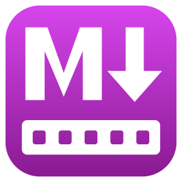

# MarkdownMovieMaker



Markdown 風の台本から、音声合成・立ち絵・字幕・BGM 付きの解説動画（MP4）を作るツールです。
Python 版（MoviePy + VOICEVOX + ffmpeg + ImageMagick）を Rust で書き直しました。

- **GUI（MarkdownMovieMaker, Windows）**: 台本エディタ、シーン一覧、プレビュー（再生・シーク）、YMM4 風のタイムライン、音声合成、書き出し。GUI フレームワークは使わず、yyeditor の Win32 部品（Direct2D/DirectWrite のエディタ・IME・同梱フォント）と Win32 の標準コントロールで作っています
- **CLI（`mmm`）**: Python 版 `s2v` と同じ引数で動画・音声・静止画を作成
- **Python・ffmpeg・ImageMagick は不要**: デコード、合成、字幕描画、H.264 / Opus エンコード、MP4 多重化まで Rust で実装しています
- **既定の音声合成は VOICEVOX**: 起動済みの VOICEVOX エンジン（HTTP）で自然な日本語音声を合成します。オフラインの軽量モデルとして Kokoro-82M（Apache-2.0）も選べます

## 音声合成エンジン

| エンジン | モデル | ライセンス | 言語 | 用途 |
| --- | --- | --- | --- | --- |
| **`voicevox`（既定）** | 起動済みの VOICEVOX エンジン（HTTP） | 各キャラクターの規約 | 日本語 | 自然な日本語音声。従来どおりの話者 ID を使用 |
| `kokoro` | [Kokoro-82M](https://huggingface.co/hexgrad/Kokoro-82M) | Apache-2.0 | 日・英など | 軽量・オフライン。CPU でも速い |
| `silent` | — | — | — | 推定の長さの無音。タイミング確認・CI 用 |

Kokoro の推論は [any-tts](https://crates.io/crates/any-tts)（Candle による純 Rust 実装）で行い、Python も ONNX Runtime も使いません。
モデルは初回の合成時に Hugging Face から自動でダウンロードします（`HF_HOME` でキャッシュ先を変更、`--kokoro-model <ディレクトリ>` でローカルのモデルを指定できます）。

- **GPU で Kokoro を推論するには `cuda` feature でビルドしてください**（CUDA Toolkit が必要）。feature なしでビルドしても Kokoro-82M は軽量なため CPU で動作します。
- 合成した音声は OS のキャッシュディレクトリ（`MMM_CACHE` で変更可）に保存し、同じセリフは合成し直しません。

## 動画の書き出し（ffmpeg 不要）

| エンコーダ | 内容 |
| --- | --- |
| **`software`**（Linux/macOS の既定） | 純 Rust の [rusty_h264](https://crates.io/crates/rusty_h264)（H.264, BSD-2）+ [rusty-opus](https://crates.io/crates/rusty-opus)（Opus）+ [muxide](https://crates.io/crates/muxide)（MP4）。GOP（既定 2 秒）ごとに独立したエンコーダを使い、フレームの描画と H.264 の符号化を CPU コア数だけ並列に行います。並列にしても逐次と同じバイト列になります |
| **`mf`**（Windows の既定） | Windows 標準の Media Foundation（H.264 / AAC）。NVIDIA GPU では NVENC が使われます。yyeditor（yytoolbox の画面録画）の実装を移植したものです |

`--encoder software` で、Windows でも純 Rust のエンコーダを使えます。
4 コアの環境で、約 5 分（1080p・30fps）の会話動画を約 48 秒で書き出せます（`--fast-encode` なら約 38 秒。音声は `silent` エンジンで計測）。
描画では、立ち絵などを拡大縮小なしで重ねる近道、文字・背景のキャッシュ、直前と同じ絵のフレームの使い回し（YUV 変換も省略）を行っています。

## ビルド

Rust 1.88 以降が必要です。

```bash
# CLI と GUI（CPU 推論）
cargo build --release -p mmm -p markdown-movie-maker

# NVIDIA GPU（RTX 3060 など）で推論する場合（CUDA Toolkit が必要）
cargo build --release -p mmm -p markdown-movie-maker --features cuda
```

- `kokoro` feature はビルド時に lindera の IPADIC 辞書をダウンロードします。ネットワークがない環境では `--no-default-features --features voicevox,software` でビルドしてください。

## 使い方

### GUI（MarkdownMovieMaker, Windows）

```bash
MarkdownMovieMaker.exe scripts/zundamon_metan_talk.md
```

PowerPoint のようにシーンをスライドとして扱います。

- **左: スライド一覧** — シーンごとのサムネイル、名前、開始時刻・長さ・セリフ数（合成済みの数）。クリックで選び、ダブルクリック（または Enter）でそのシーンだけを再生します。↑↓ で前後のシーン。
- **中央: 選んだシーンのプレビュー** — その下に再生操作（[◀ 前] [▶ このシーン] [▶ 通して再生] [次 ▶]、シーン内の経過時間）、**ノート**（このシーンのセリフ）、タイムラインが並びます。
  - 「このシーン」(F5) はシーンの頭から終わりまで再生して止まります。「通して再生」(Shift+F5) は今の位置から最後まで再生します。プレビューをクリックしても再生・停止します。
  - ノートのセリフをクリックするとその位置へ移動し、ダブルクリックでそのセリフだけを合成してシーンの終わりまで再生します。
  - タイムライン: シーン・セリフ・立ち絵・アイテム・音声の帯。クリック・ドラッグで移動、ホイールで拡大縮小、Shift+ホイールで左右に送り、帯のダブルクリックで台本のその行へ。
- **右: 台本エディタ**（yyeditor のエディタ部品。日本語入力はインライン表示）。入力が止まって約 0.3 秒でスライド・プレビューに反映され、キャレットのあるセリフのシーンが選ばれます。その下のメッセージ欄で「n 行目: …」をダブルクリックするとその行へ移動します。
- 合成前のセリフは推定の長さでプレビューします（ノートの `[推定]`）。「音声を合成」(F6) で実際の音声に置き換わります（`[済]`）。F7 はキャレットのあるセリフだけを合成して再生します。
- 「プロジェクト → 声を試聴」、「キャラクター定義を開く」「読み直す」、「書き出し…」(Ctrl+E、拡張子で MP4 / MP3 / WAV / PNG)、「設定」で解像度・フレームレート・エンコーダ・合成デバイス。
- Ctrl+PageUp / PageDown で前後のシーン、Ctrl+S で保存、Ctrl+O で開く。
- **F1 でヘルプ**（yyeditor と同じく同梱の [help.md](apps/markdown-movie-maker/help/help.md) を WebView2 で表示）。フォーカスのある場所（エディタ → 台本の書き方、スライド、タイムラインなど）に応じた項目を開きます。

### CLI

```bash
mmm scripts/zundamon_metan_talk.md --out data/outputs/sample.mp4
```

| オプション | 説明 |
| --- | --- |
| `<台本>...` | 台本ファイル。複数指定すると順につなげて 1 本の動画にします（Python 版の `concatenate_videos` の代わり） |
| `--out` | 出力先（既定 `output.mp4`） |
| `--chars` | キャラクター定義（既定 `<root>/data/character_master.json`） |
| `--font`（`--font_path`） | 字幕フォント（既定は埋め込みの M+ 1 Bold） |
| `--bgm`（`--bgm_path`）/ `--no-bgm` / `--bgm-volume` | 全体 BGM（既定 `data/bgm/default_bgm.mp3`、音量 0.1） |
| `--engine` | すべてのキャラクターに使うエンジン（`voicevox` / `kokoro` / `silent`）。省略時はキャラクター定義に従います |
| `--device` | `auto`（既定）/ `cuda:0` / `cpu` |
| `--size` / `--fps` | 解像度（既定 `1920x1080`）とフレームレート（既定 30） |
| `--encoder` | `auto` / `software` / `mf` |
| `--fast-encode` | 純 Rust エンコーダを速さ優先にする（下書き向け。ファイルは 1〜4 割大きくなる） |
| `--audio-only` | 音声だけを MP3（拡張子が `.wav` なら WAV）で書き出します |
| `--image-only` | セリフごとの静止画（PNG）を書き出します（音声合成はしません） |
| `--root` | 台本中の相対パスの基準（既定は `data/character_master.json` がある祖先ディレクトリ） |
| `--no-cache` / `--cache-dir` | 合成音声のキャッシュ |

補助コマンド（Python 版 `script2video/tools` と PowerShell スクリプトの置き換え）:

```bash
mmm voices --engine voicevox         # 話者の一覧
mmm gif data/character/gif_list.csv  # 2 枚の画像を交互に表示する GIF（create_gif.py）
mmm bounce-gif in.png --out out.gif --height 20 --duration 0.5   # make_bouncing_gif.py
mmm variation --character-id zundamon --base-variation default --new-variation smile2   # create_variation.py
mmm flip data/character              # 画像を左右反転して *_left.png を作る（ConvertImage.ps1）
```

## 台本の書き方

Python 版と同じ Markdown 風の台本に、ゆっくりMovieMaker4（YMM4）の編集機能の大半を書けるよう拡張しました。
すべての構文は、アプリに同梱のヘルプ **[apps/markdown-movie-maker/help/help.md](apps/markdown-movie-maker/help/help.md)**（GUI では F1）にあります。デモは [`scripts/ymm4_features_demo.md`](scripts/ymm4_features_demo.md) です。

```markdown
# Scene@オープニング

- bg: data/bg/Blackboard.png {scale: 1.15->1, fx: blur(6)}
- transition: wipe-left 0.6
- text: "タイトル" {size: 110, color: #ffe000, outline: 6 #000 | 12 #fff, in: pop 0.6}
- id: zundamon@default_left {in: slide-left 0.5}
- id: metan@default
- bgm: data/bgm/001.mp3 {volume: 0.15, fade_in: 1}

## Lines
zundamon: ｜詐欺《さぎ》の話なのだ！ {pitch: 1.1, motion: bounce(30), wait: 0.5}
metan@komatta: 表情はセリフごとに変えられますわ。
```

- アイテム: テキスト（多重縁取り・影・背景・縦書き・文字送り）、画像、動画（MP4）、図形
- レイヤー、開始・終了時刻（`at: L2` でセリフに合わせる）、中間点アニメーションと補間
- 表示/非表示アニメーション（ぱりーんと割れる `shatter` を含む）、映像エフェクト 20 種類、合成モード、カメラ、場面切り替え 15 種類
- セリフごとの表情・読み（ルビ）・速度・高さ・音量・前後の間・動き・効果音
- パーツ方式の立ち絵による目パチと「あいうえお」口パク

### Python 版からの変更点（既存の台本の動き）

- セリフの `:` の後の空白は省略でき、全角の `：` も使えます（Python 版では空白のないセリフが黙って捨てられていました）。
- 解釈できない行・未知の設定キーは警告として表示します（GUI では該当行へ移動できます）。
- `bgm:` を実装しました（Python 版では読み込むだけで使われていませんでした）。
- `sound:` はシーンの開始時に 1 回だけ鳴らします（Python 版ではセリフごとに鳴り直していました）。3 番目の値で開始位置を指定できます。
- 口パクは音声の音量から有声区間を求め、その間だけ口を開閉します（Python 版は音声と無関係に 10Hz で開閉）。パーツ方式の立ち絵では母音に合わせて口の形を変えます。
- 既定のフレームレートは 30fps です（Python 版は 12fps。`--fps 12` で同じにできます）。
- 純 Rust のエンコーダの音声は Opus です（Media Foundation では AAC）。

## キャラクター定義（`data/character_master.json`）

Python 版の形式をそのまま読み、音声合成の設定 `voice` を追加できます。

```json
"zundamon": {
    "name": "ずんだもん",
    "speaker_id": 3,
    "voice": {"engine": "voicevox", "language": "ja"},
    "variations": { "default": {"image_closed": "...", "image_open": "...", "scale": 0.9, "pos": [1200, 300]} },
    "subtitle_style": {"fontsize": 70, "color": "green", "border_color": "green"}
}
```

| `voice` のキー | 説明 |
| --- | --- |
| `engine` | `voicevox`（既定）/ `kokoro` |
| `speaker` | 話者名（Kokoro の `jf_alpha` など）。VOICEVOX では `speaker_id` を使います |
| `language` | `ja` / `en` / `auto`（既定。かな・漢字を含めば日本語） |
| `speed` / `volume` | 速度・音量の倍率 |

`data/voice_dictionary.csv`（`表記,読み`）は、Kokoro では合成前に表記を読みへ置き換え、VOICEVOX ではユーザー辞書へ登録します。

## 素材の入手先（同梱していないファイル）

第三者が権利を持つ画像・音声素材は、再配布規約の都合上リポジトリに同梱していません（`.gitignore` で `data/*` を除外しています）。サンプル台本（`scripts/`）をそのまま動かす場合は、各配布元の利用規約を確認のうえ、以下のサイト等から入手して `data/` 配下に配置してください。

| 配置先 | 内容 | 主な入手先 |
| --- | --- | --- |
| `data/character/` | キャラクター立ち絵（ずんだもん・四国めたん・春日部つむぎ等） | [VOICEVOX 公式サイト](https://voicevox.hiroshiba.jp/)（キャラクター規約・素材リンク）、ニコニコ静画・BOOTH 等の立ち絵配布ページ。左右反転（`*_left.png`）は `mmm flip data/character` で作成できます |
| `data/bg/` | 背景画像（教室・黒板・街並み等） | [みんちりえ](https://min-chi.material.jp/) などのフリー背景素材サイト |
| `data/overlay/` | 解説用イラスト・挿絵 | [いらすとや](https://www.irasutoya.com/) などのフリーイラスト素材サイト |
| `data/sound/` | 効果音（`.mp3`） | [効果音ラボ](https://soundeffect-lab.info/) などのフリー効果音サイト |
| `data/bgm/` | BGM（`default_bgm.mp3`, `001.mp3`〜`004.mp3`） | [DOVA-SYNDROME](https://dova-s.jp/) などのフリーBGMサイト、または自前の楽曲・生成AI（Lyria Studio 等）で作成した音声 |

※ `data/fonts/` の M+ フォント（SIL OFL）および自作の図解・SVG 素材は再配布可能です。

## 構成

| パス | 役割 |
| --- | --- |
| `crates/mmm-core` | 台本のモデル・パーサー・キャラクター定義・タイムライン |
| `crates/mmm-audio` | デコード（symphonia）、リサンプル、WSOLA、ミックス、WAV / MP3（rusty_mp3）書き出し |
| `crates/mmm-render` | フレーム合成（背景・立ち絵・エフェクト・口パク・字幕・アニメーション GIF） |
| `crates/mmm-tts` | 音声合成（VOICEVOX / Kokoro）、読み辞書、キャッシュ |
| `crates/mmm-encode` | MP4 書き出し（純 Rust の GOP 並列エンコーダ / Media Foundation） |
| `crates/mmm-pipeline` | 台本 → 音声 → タイムライン → MP4 / MP3 / PNG（CLI と GUI で共有） |
| `apps/mmm` | CLI（`mmm`） |
| `apps/markdown-movie-maker` | GUI（Windows。`studio.rs` が OS に依存しない状態と処理、`win/` が Win32 の画面、`help/help.md` が同梱のヘルプ、`res/` がアイコンとマニフェスト） |
| `tools/gen-icon` | アプリアイコン（`res/MarkdownMovieMaker.ico`）を作る（`cargo run -p mmm-gen-icon`） |

### yyeditor から流用したもの

- Media Foundation の SinkWriter による H.264 / AAC 書き出し（`yytoolbox` の画面録画）→ `mmm-encode/src/mf.rs`
- 純 Rust のストリーミング MP3 エンコーダ（`yytoolbox` の録音）→ `mmm-audio/src/mp3.rs`
- Studio の画面: `yy-ui-win` のエディタ（Direct2D/DirectWrite、IME のインライン変換、同梱の UDEV Gothic）を、yydbmanager の SQL エディタと同じ方法で組み込んでいます（Cargo の git 依存。yyeditor は GPL-3.0-or-later なので、Studio の配布物もその条件に従います）
- ワークスペースの方針（`unsafe_code = "deny"` で OS 境界だけ許可、`cargo clippy -D warnings`、Windows/Linux CI）

## 開発

```bash
cargo fmt --all -- --check
cargo clippy --workspace --all-targets -- -D warnings
cargo test --workspace
```

テストは `silent` エンジンとリポジトリの素材で、台本から MP4・MP3・PNG までを通して確認します。
